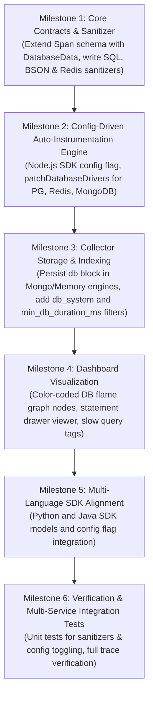

# Doomwatch: Database & Cache Auto-Instrumentation Implementation Plan

**Date & Time:** November 8, 2026, 01:05:00 IST  
**Document Version:** 1.1  
**Status:** In Progress / Implementing  

---

## Document Revision Changelog

| Version | Date & Time | Author | Summary of Changes / Reasoning |
| :--- | :--- | :--- | :--- |
| **1.0** | November 5, 2026, 22:49:32 IST | Doomwatch Team | Initial architectural plan and phased implementation roadmap for Database & Cache auto-instrumentation across Node.js, Python, and Java SDKs. |
| **1.1** | November 8, 2026, 01:05:00 IST | Doomwatch Team | **Config-Driven Architecture Update**: Made database and cache auto-instrumentation strictly configurable and driven from application configuration via a single top-level flag (`instrumentDatabase`, defaulting to `true`). Specified config schema across Node.js, Python, and Java SDKs with environment variable overrides (`DOOMWATCH_INSTRUMENT_DATABASE`). Documented zero-overhead opt-out lifecycle, synchronous vs. asynchronous request path overhead, production safeguards (2KB statement truncation, queue drop, fail-open), and updated milestone roadmap. |

> **Note on Versioning:** Whenever this document is updated during subsequent discussions, the version number will be incremented (e.g. 1.1, 2.0) and the table above must record the specific reasoning and changes made.

---

## 1. Executive Summary & Objective

In modern microservices, between 70% and 80% of backend latency and production incidents stem from database bottlenecks, missing indexes, unoptimized queries, N+1 query storms, and cache inefficiencies.

Currently, Doomwatch instruments incoming HTTP (`SERVER` spans) and outgoing HTTP (`CLIENT` spans). All time spent in databases or caches is treated as an opaque "black box" lumped into the parent service's execution time.

### Primary Goals:
1. **Zero-Touch Instrumentation**: Automatically capture database and cache spans without requiring developers to manually wrap individual query calls.
2. **Config-Driven Activation & Zero-Overhead Opt-Out**: Provide a single top-level configuration flag (`instrumentDatabase: boolean`, default: `true`). If disabled by the user in configuration or via environment variable, all database and cache auto-instrumentation hooks and listeners are completely bypassed, guaranteeing zero runtime overhead.
3. **Causal DAG Nesting**: Every query or cache operation is recorded as a `CLIENT` child span nested underneath the active ambient HTTP span via OpenTelemetry / contextvars / ThreadLocal context.
4. **Data Privacy & Query Sanitization**: Prevent credentials and PII from leaking into traces by parameterizing and masking query statements before serialization.
5. **Actionable Flame Graph Visualization**: Clearly distinguish database types (MongoDB, PostgreSQL, Redis) in the dashboard with timing breakdowns, slow query warnings (>100ms), and statement inspections.

---

## 2. Configuration & Control Architecture (Driven from Config)

A core tenet of this feature is that **database and cache auto-instrumentation is driven entirely from configuration**. Developers can easily turn the feature off or tune it without modifying business code.

### 2.1 Configuration Design Principles
* **Enabled by Default**: Out of the box, `instrumentDatabase` defaults to `true`. Installing or initializing the Doomwatch SDK immediately captures database queries and cache commands without requiring extra configuration.
* **Single Flag Opt-Out**: A single top-level boolean flag (`instrumentDatabase: false`) completely turns off all database and cache instrumentation across all supported drivers.
* **Zero Overhead when Disabled**: When `instrumentDatabase: false`, no monkey patches are applied, no command listeners are registered, and no event loop hooks are bound. The SDK behaves as if the database instrumentation modules do not exist.
* **Granular Options Support**: For advanced use cases, `instrumentDatabase` can also accept an options object to enable or disable specific drivers individually (e.g. enabling MongoDB while disabling Redis).
* **Environment Variable Fallback**: Can be configured via environment variable `DOOMWATCH_INSTRUMENT_DATABASE=true|false|1|0`, enabling ops and SREs to toggle instrumentation without redeploying code.

---

### 2.2 SDK Configuration Contracts

#### 1. Node.js SDK (`@doomwatch/node`)

```typescript
export interface DatabaseInstrumentationOptions {
  enabled?: boolean;            // Master toggle for DB/cache (default: true)
  mongodb?: boolean;            // Enable MongoDB driver & Mongoose auto-instrumentation (default: true)
  postgres?: boolean;           // Enable PostgreSQL (pg) auto-instrumentation (default: true)
  redis?: boolean;              // Enable Redis (ioredis / node-redis) auto-instrumentation (default: true)
  maxStatementBytes?: number;   // Maximum statement byte length before truncation (default: 2048)
}

export interface DoomwatchNodeConfig {
  serviceName: string;
  collectorUrl?: string;
  environment?: string;
  maxBodyBytes?: number;
  batchIntervalMs?: number;
  batchSize?: number;
  redactedKeys?: string[];
  autoPatchHttp?: boolean;
  debug?: boolean;

  /**
   * Enable or disable automatic database and cache instrumentation.
   * - Set to `false` to completely disable all DB & cache instrumentation.
   * - Set to `true` (default) to enable all supported drivers (MongoDB, PG, Redis).
   * - Or pass a `DatabaseInstrumentationOptions` object for granular per-driver control.
   */
  instrumentDatabase?: boolean | DatabaseInstrumentationOptions;
}
```

**Usage Examples:**

```typescript
import { Doomwatch } from '@doomwatch/node';

// Default: Database & cache auto-instrumentation enabled
Doomwatch.init({
  serviceName: 'order-service'
});

// Single-flag opt-out: Completely disable DB & cache instrumentation
Doomwatch.init({
  serviceName: 'order-service',
  instrumentDatabase: false
});

// Granular driver configuration:
Doomwatch.init({
  serviceName: 'order-service',
  instrumentDatabase: {
    mongodb: true,
    postgres: true,
    redis: false // Keep Redis disabled
  }
});
```

#### 2. Python SDK (`doomwatch-python`)

```python
@dataclass
class DatabaseInstrumentationConfig:
    enabled: bool = True
    mongodb: bool = True
    postgres: bool = True
    redis: bool = True
    max_statement_bytes: int = 2048

@dataclass
class DoomwatchConfig:
    service_name: str
    collector_url: str = "http://localhost:4000"
    environment: str = "development"
    max_body_bytes: int = 4096
    batch_interval_ms: int = 1000
    batch_size: int = 50
    redacted_keys: Optional[List[str]] = None
    auto_patch_http: bool = True
    instrument_database: Union[bool, DatabaseInstrumentationConfig] = True
    debug: bool = False
```

```python
# Initializing with single-flag toggle:
Doomwatch.init(
    service_name="payment-service",
    instrument_database=False  # Disabled via config
)
```

#### 3. Java SDK (`doomwatch-java`)

```java
DoomwatchConfig config = DoomwatchConfig.builder("inventory-service")
    .collectorUrl("http://localhost:4000")
    .instrumentDatabase(false) // Single flag opt-out
    .build();

Doomwatch.init(config);
```

---

## 3. Overhead Analysis: Synchronous vs. Asynchronous Lifecycle & Safeguards

To address production performance concerns, the execution lifecycle is partitioned into **in-band synchronous operations** (measured in microseconds) and **out-of-band asynchronous operations** (completely decoupled from the critical path).

```
User Request Path:
  [Incoming Request] ──> [PG Query Execution (15ms)] ───────────> [HTTP Response]
                              │                                         ▲
                              │ (In-band synchronous: ~15-30µs)        │
                              ├── Start time & context lookup           │
                              ├── SQL regex sanitization & truncation   │
                              └── queue.push(span) ─────────────────────┤
                                                        │
Asynchronous Background Path:                           │ (Detached memory queue)
                                                        ▼
                                       [Background Exporter Timer / Batch]
                                                        │
                                                        ▼ (Non-blocking HTTP POST)
                                           [Doomwatch Collector Ingestion]
```

### 3.1 Synchronous Overhead In The Critical Path
During query execution, the wrapper executes only lightweight in-memory CPU operations:
1. **Start Time Recording**: `performance.now()` (~10 nanoseconds).
2. **Context Lookup**: Retrieves active `trace_id` and parent `span_id` from in-memory `AsyncLocalStorage` (~50 nanoseconds).
3. **Query Sanitization**: Strips comments and substitutes literals with `?` (~10–30 microseconds for queries <2KB).
4. **Duration Calculation & Enqueue**: `Date.now() - startTime` and array `queue.push()` into an in-memory buffer (~20 nanoseconds).

Total synchronous time added to the event loop: **~15 to 50 microseconds (0.015 to 0.05 milliseconds)**, which is <0.1% of a typical 20ms database query.

### 3.2 Asynchronous Out-of-Band Path
* **Zero Synchronous Network Calls**: The SDK never awaits the collector or makes synchronous network requests during database execution.
* **Background Batch Flush**: Spans sit in an in-memory queue until flushed asynchronously by a recurring timer (e.g. every 1,000ms) or when reaching the batch threshold (e.g. 50 spans).
* **Isolated Writes**: Storage persistence occurs in the standalone Doomwatch Collector process.

### 3.3 Built-In Production Safeguards
1. **Statement Byte Truncation**: SQL, BSON, and Redis statements are truncated at `maxStatementBytes` (default: 2,048 bytes) before regex processing to avoid event loop stalling on large bulk inserts.
2. **Ring Buffer & Queue Dropping**: The in-memory buffer enforces `maxQueueCapacity: 5000`. If collector connectivity degrades, oldest spans are discarded to prevent memory leaks.
3. **Fail-Open Philosophy**: Every database hook is wrapped in a `try...catch`. Any exception in tracing or sanitization is caught and swallowed silently so application queries are never interrupted.

---

## 4. Core Telemetry Data Contracts

We extend the `Span` model in `@doomwatch/core` (and mirror in Python and Java SDKs) with a dedicated `db` metadata block:

```typescript
export type DatabaseSystem =
  | 'mongodb'
  | 'postgresql'
  | 'mysql'
  | 'redis'
  | 'memcached';

export type DatabaseOperation =
  | 'find'
  | 'insert'
  | 'update'
  | 'delete'
  | 'aggregate'
  | 'count'
  | 'SELECT'
  | 'INSERT'
  | 'UPDATE'
  | 'DELETE'
  | 'GET'
  | 'SET'
  | 'DEL'
  | 'HGET'
  | 'HSET';

export interface DatabaseData {
  system: DatabaseSystem;
  name?: string;                     // Database name (e.g., 'production_db')
  statement?: string;                // Sanitized, parameterized query or command
  operation?: DatabaseOperation | string;
  collection_or_table?: string;      // Collection (Mongo) or Table (SQL)
  rows_affected?: number;            // Count of affected rows or documents
  cache_hit?: boolean;               // For Redis/Memcached (true = hit, false = miss)
}
```

### Span Attribute Mapping:
* **`span_kind`**: `CLIENT`
* **`name`**: `{system}: {operation} {collection_or_table}`  
  *(e.g., `mongodb: find orders`, `postgresql: SELECT users`, `redis: GET session_token`)*
* **`db`**: `DatabaseData`
* **`duration_ms`**: Measured execution time in milliseconds.
* **`error`**: Captured database driver exception or query timeout details.

---

## 5. Query Sanitization & PII Masking Engine

Logging raw SQL or BSON queries introduces compliance and security risks (leaking passwords, credit cards, or personal emails). The SDKs implement an automated sanitization engine in `@doomwatch/core`:

### 5.1 SQL Parameterization & Sanitization
* All string literals (`'value'`, `"value"`), numeric constants (`1234`), hex strings, and UUIDs are substituted with placeholder `?`.
* SQL comments (`--`, `/* */`) are stripped.
* Truncated to configured byte cap (default: 2,048 bytes).
* **Example**:
  ```sql
  -- Before Sanitization:
  SELECT * FROM users WHERE email = 'alice@example.com' AND age > 21;
  -- After Sanitization:
  SELECT * FROM users WHERE email = ? AND age > ?;
  ```

### 5.2 MongoDB Filter Sanitization
* MongoDB query and command objects (BSON/JSON) recursively replace leaf values with `?`, while preserving query operators (`$in`, `$gt`, `$and`, `$set`):
* **Example**:
  ```json
  // Before Sanitization:
  { "account_id": "acc-9921", "status": "active", "balance": { "$gt": 500 } }
  // After Sanitization:
  { "account_id": "?", "status": "?", "balance": { "$gt": "?" } }
  ```

### 5.3 Redis Command Masking
* For commands dealing with user data (`SET`, `HSET`), key prefixes are retained, but value arguments are redacted to `[REDACTED]`.
* Safe commands (`GET`, `DEL`, `EXISTS`, `KEYS`) retain the key name.

---

## 6. SDK Auto-Instrumentation Architecture

### Phase 1: Node.js SDK (`@doomwatch/node`)

When `Doomwatch.init()` executes, it checks `config.instrumentDatabase`:
1. If `instrumentDatabase === false` (or `enabled === false`), driver patching is completely skipped.
2. Otherwise, `patchDatabaseDrivers(options)` installs hooks for installed packages:

#### 1. MongoDB Driver (`mongodb` and `mongoose`)
* **Mechanism**: Register a Command Monitoring listener on `MongoClient` (`commandStarted`, `commandSucceeded`, `commandFailed`).
* **Advantage**: Zero monkey-patching of internals; supported natively by all modern versions of `mongodb` (v4, v5, v6) and Mongoose.
* **Flow**:
  1. `commandStarted` $\rightarrow$ capture start time, ambient trace context, sanitized BSON filter.
  2. `commandSucceeded` $\rightarrow$ calculate duration, record rows returned / documents affected, enqueue span.
  3. `commandFailed` $\rightarrow$ capture driver error, enqueue span.

#### 2. PostgreSQL (`pg`)
* **Mechanism**: Intercept `pg.Client.prototype.query` and `pg.Pool.prototype.query`.
* **Flow**: Capture SQL text, parameterize, measure execution promise/callback, capture `rowCount`, enqueue span.

#### 3. Redis (`ioredis` and `redis`)
* **Mechanism**: Intercept `ioredis.prototype.sendCommand`.
* **Flow**: Capture command name (`GET`, `SET`), compute duration, flag cache hit/miss if result is `null` or present.

---

### Phase 2: Python SDK (`doomwatch-python`)

#### 1. PyMongo
* **Mechanism**: Register a `pymongo.monitoring.CommandListener`.
* **Implementation**: Implements `started()`, `succeeded()`, `failed()` callbacks, binds to active Python `contextvars` context.

#### 2. SQLAlchemy & Psycopg
* **Mechanism**: Attach to SQLAlchemy event hooks (`before_cursor_execute`, `after_cursor_execute`).
* **Implementation**: Extracts clean parameterized statement from SQLAlchemy engine events.

#### 3. Redis (`redis-py`)
* **Mechanism**: Wrap `redis.Redis.execute_command`.

---

### Phase 3: Java SDK (`doomwatch-java`)

#### 1. MongoDB Java Driver
* **Mechanism**: Register a `com.mongodb.event.CommandListener` with `MongoClientSettings.Builder`.

#### 2. JDBC Driver / Spring Data / Hibernate
* **Mechanism**: Provide a standard JDBC `DataSource` proxy wrapper (`DoomwatchDataSource`) or Spring BeanPostProcessor to trace `PreparedStatement.execute*`.

#### 3. Redis (Jedis & Lettuce)
* **Mechanism**: Lettuce `CommandListener` or Jedis client wrapper.

---

## 7. Collector & Storage Layer Updates

### 7.1 Storage Schema Update (`packages/collector`)
* Extend storage models (`MongoStorageEngine`, `MemoryStorageEngine`) to store and index `db` metadata.
* Add compound index on MongoDB storage:
  ```javascript
  db.spans.createIndex({ "db.system": 1, "db.collection_or_table": 1, "duration_ms": -1 });
  ```

### 7.2 Query Filtering & Search
* Extend `GET /v1/traces` query parameters:
  * `db_system`: Filter traces that executed queries on a specific database (e.g. `postgresql`, `mongodb`, `redis`).
  * `min_db_duration_ms`: Filter traces where database execution exceeded a threshold (e.g. slow queries $>500\text{ms}$).

---

## 8. Web Dashboard Enhancements (`packages/dashboard`)

### 8.1 Flame Graph Visual Distinction
* Database and cache spans are rendered with distinctive iconography and colors:
  * **MongoDB**: Emerald Green badge (`mongodb: find documents`)
  * **PostgreSQL / MySQL**: Cyan / Dark Blue badge (`postgresql: SELECT users`)
  * **Redis**: Crimson / Orange badge (`redis: GET session`)
* "Slow Query" warning tag rendered automatically if `duration_ms > 100ms`.

### 8.2 Detail Drawer Tab
* Clicking a database span opens the Drawer displaying:
  * **System & Operation**: e.g., `MongoDB` $\rightarrow$ `find`
  * **Target Collection/Table**: e.g., `orders`
  * **Sanitized Statement**: Code block formatted with syntax highlighting.
  * **Duration & Timestamp**: Millisecond timing and offset.
  * **Rows Affected / Cache Result**: `42 rows` or `Cache HIT` / `Cache MISS`.

---

## 9. Phased Implementation Roadmap & Milestones



---

## 10. Verification & Testing Strategy

1. **Unit Testing**:
   * Verify SQL tokenizer replaces all literal strings, numbers, hex, and UUIDs with `?`.
   * Verify MongoDB filter sanitizer recursively masks sensitive object fields while retaining query operators.
   * Verify Redis command masking redacts values on `SET`/`HSET` while preserving safe commands and keys.
   * Verify payload byte truncation prevents oversized query strings.
   * Verify `instrumentDatabase: false` completely bypasses driver interception.
2. **Integration Testing**:
   * Verify that calling PostgreSQL query, MongoDB command, or Redis command inside an HTTP request automatically creates a child span with the exact `parent_span_id` of the HTTP span.
   * Verify Collector ingestion, storage in memory and MongoDB, and querying with `db_system` and `min_db_duration_ms`.
3. **End-to-End Verification**:
   * Verify dashboard rendering with colored database badges, slow query indicators, and drawer statement viewer.
