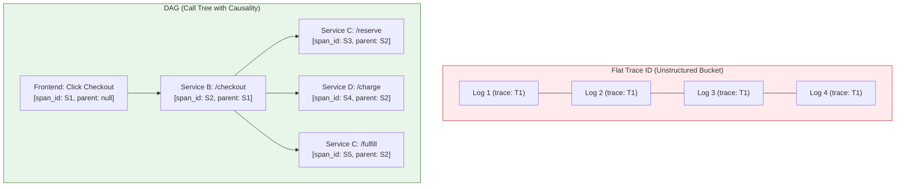
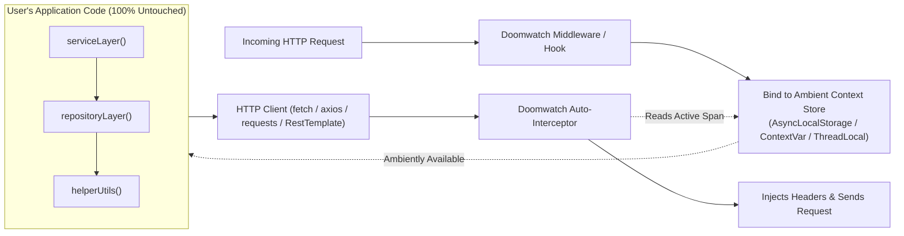
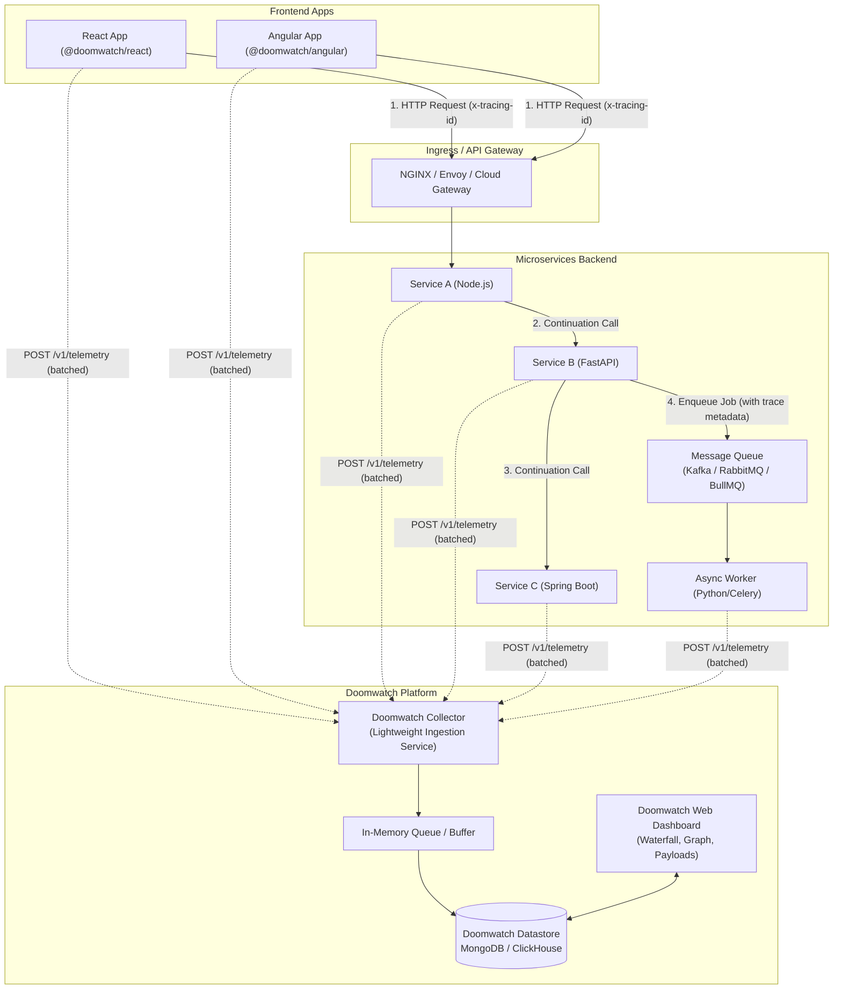
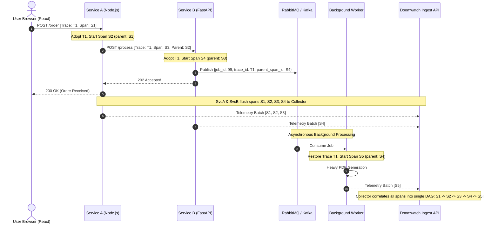
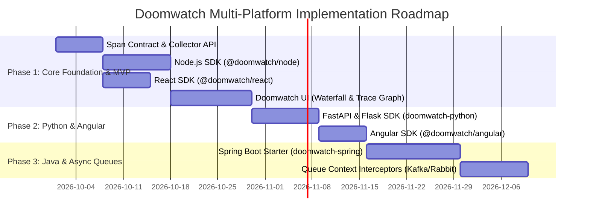

# Doomwatch: Architecture, Context Propagation & DAG Specification

## 1. Deep Dive: Flat Trace ID vs. Directed Acyclic Graph (DAG)

### 1.1 The Core Limitation of a Flat Trace ID
In a flat trace ID model, every service attaches the exact same identifier (`trace_id: "T-100"`) to its logs and events. 

Suppose a user initiates a checkout on an e-commerce platform. The React frontend calls Service B (Order Service), which in turn executes three operations:
1. Calls Service C (Inventory Service) to reserve items.
2. Calls Service D (Payment Gateway) to process the charge.
3. Calls Service C (Inventory Service) a second time to confirm fulfillment.

If we only store a flat `trace_id = "T-100"`, the database stores a flat collection of records:

| Record | Service | Operation | Timestamp | Duration | Trace ID |
| :--- | :--- | :--- | :--- | :--- | :--- |
| 1 | Frontend | `POST /checkout` | 10:00:00.000 | 1200ms | `T-100` |
| 2 | Service B | `POST /checkout` | 10:00:00.050 | 1100ms | `T-100` |
| 3 | Service C | `POST /reserve` | 10:00:00.100 | 200ms | `T-100` |
| 4 | Service D | `POST /charge` | 10:00:00.350 | 500ms | `T-100` |
| 5 | Service C | `POST /fulfill` | 10:00:00.900 | 150ms | `T-100` |

#### Why this causes critical observability failures:
1. **Lost Causality (Who called whom?)**:
   Looking at Record 3 and Record 4, did Service B call Service C and D? Or did Service C call Service D? With only a flat ID, there is no parent-child relationship.
2. **Concurrency & Parallelism Blindness**:
   Did Service B wait for Inventory reservation before calling Payment? Or did it call them in parallel using `Promise.all()` / async workers? In a flat table, you cannot distinguish sequential dependency from concurrent execution.
3. **Inability to build a Waterfall (Flame Graph)**:
   You cannot calculate **self-time** vs. **waiting-for-downstream time**. If Service B took 1100ms, was Service B slow, or was Service D (Payment) slow?
4. **Loop / Repeated Call Ambiguity**:
   When Service C is called twice in the same request, flat logs cannot correlate which logs inside Service C belong to call #1 vs. call #2.

---

### 1.2 How a DAG Solves This Completely

A **Directed Acyclic Graph (DAG)** introduces two additional IDs:
* **`span_id`**: A unique ID for *this specific execution step / hop*.
* **`parent_span_id`**: The `span_id` of the caller that initiated this step (null for the root).

#### What the Data Looks Like with a DAG:

```json
[
  { "service": "Frontend",  "span_id": "span-1", "parent_span_id": null,     "name": "Click Checkout" },
  { "service": "Service B", "span_id": "span-2", "parent_span_id": "span-1", "name": "POST /checkout" },
  { "service": "Service C", "span_id": "span-3", "parent_span_id": "span-2", "name": "POST /reserve" },
  { "service": "Service D", "span_id": "span-4", "parent_span_id": "span-2", "name": "POST /charge" },
  { "service": "Service C", "span_id": "span-5", "parent_span_id": "span-2", "name": "POST /fulfill" }
]
```

#### Visual Comparison: Flat vs. DAG



#### Waterfall Timeline Rendered in the UI via DAG:

```
[Frontend: Click Checkout ---------------------------------------------- 1200ms]
  └── [Service B: /checkout -------------------------------------------- 1100ms]
        ├── [Service C: /reserve ---------- 200ms]
        ├── [Service D: /charge --------------------------- 500ms]
        └── [Service C: /fulfill ------- 150ms]
```

With the DAG, Doomwatch can instantly pinpoint:
* **Critical Path**: Payment (`Service D`) consumed 500ms of the total 1100ms.
* **Failure Blast Radius**: If `Service D` fails, the exact sub-branch that died is immediately isolated.

---

## 2. Context Propagation Without Code Changes (Zero-Touch DX)

### 2.1 The Principle: "No Manual Parameter Passing"
Users should **never** have to rewrite their business functions like this:
```javascript
// BAD OBSERVABILITY DESIGN (DO NOT DO THIS)
async function processOrder(orderId, traceId) { // <- Forced code modification!
  await saveToDb(orderId, traceId);
  await callPayment(orderId, traceId);
}
```

Instead, Doomwatch uses **ambient runtime context** and **automatic interception** (often called auto-instrumentation or monkey-patching). The developer writes normal code, and Doomwatch tracks the context invisibly.

### 2.2 How Ambient Context Works Under the Hood

Every runtime has an engine-level feature that carries state through asynchronous execution chains without modifying function signatures:



---

### 2.3 User Experience in Each Supported Language

#### A. Node.js (Express / Fastify / NestJS)
The user only imports Doomwatch at the entry point. All existing code remains unchanged.

```javascript
// index.js - That's it! 2 lines added.
const doomwatch = require('@doomwatch/node');
doomwatch.init({ collectorUrl: 'http://localhost:4000', serviceName: 'order-service' });

// -------------------------------------------------------------
// USER'S EXISTING CODE BELOW (ZERO CHANGES)
// -------------------------------------------------------------
const express = require('express');
const axios = require('axios');
const app = express();

app.post('/checkout', async (req, res) => {
  // Doomwatch automatically intercepted this incoming call and set AsyncLocalStorage!
  
  // When user calls axios or fetch, Doomwatch's patched http client
  // automatically reads AsyncLocalStorage and attaches x-tracing-id and x-parent-id!
  const inventory = await axios.post('http://inventory-service/reserve', req.body);
  const payment = await axios.post('http://payment-service/charge', { amount: 100 });

  res.json({ status: 'confirmed', inventory: inventory.data, payment: payment.data });
});
```

#### B. Python (FastAPI / Flask)
```python
# main.py - 2 lines added
from fastapi import FastAPI
import doomwatch
import requests

app = FastAPI()
doomwatch.init(app, collector_url="http://localhost:4000", service_name="order-service")

# -------------------------------------------------------------
# USER'S EXISTING CODE BELOW (ZERO CHANGES)
# -------------------------------------------------------------
@app.post("/checkout")
def checkout():
    # Doomwatch automatically auto-instruments the 'requests' or 'httpx' library
    # using Python's contextvars!
    resp = requests.post("http://inventory-service/reserve")
    return {"status": "ok", "inventory": resp.json()}
```

#### C. Java (Spring Boot)
Zero Java code changes. The user only adds the starter dependency and a configuration entry:

```xml
<!-- pom.xml -->
<dependency>
    <groupId>com.doomwatch</groupId>
    <artifactId>doomwatch-spring-boot-starter</artifactId>
    <version>1.0.0</version>
</dependency>
```

```yaml
# application.yml
doomwatch:
  collector-url: http://localhost:4000
  service-name: order-service
```
Spring Boot's auto-configuration automatically registers the `Filter` for incoming requests and customizes `RestTemplate` / `WebClient` for outgoing requests via `ThreadLocal`.

---

## 3. End-to-End System Architecture

### 3.1 High-Level Topology
All services and frontends report to a **Doomwatch Ingest Collector**, ensuring database credentials and internal topology remain secure.



---

### 3.2 Asynchronous Request & Trace Context Propagation Flow

This sequence demonstrates how a single trace transitions seamlessly from synchronous calls through an asynchronous queue and background worker:



---

## 4. Telemetry Data Model (Span Contract)

Every log and request/response event captured by Doomwatch adheres to this unified JSON structure:

```json
{
  "trace_id": "4bf92f3577b34da6a3ce929d0e0e4736",
  "span_id": "00f067aa0ba902b7",
  "parent_span_id": "5a3e12bb43f89012",
  "service_name": "order-service",
  "runtime": "node-v20",
  "span_kind": "SERVER",
  "name": "POST /api/v1/orders",
  "start_time_unix_ms": 1726950000100,
  "end_time_unix_ms": 1726950000350,
  "duration_ms": 250,
  "http": {
    "method": "POST",
    "url": "https://api.domain.com/api/v1/orders",
    "route": "/api/v1/orders",
    "status_code": 201,
    "request_headers": {
      "content-type": "application/json",
      "user-agent": "Mozilla/5.0..."
    },
    "request_body": {
      "item_id": "ITEM-101",
      "quantity": 2
    },
    "response_headers": {
      "content-type": "application/json"
    },
    "response_body": {
      "order_id": "ORD-9988",
      "status": "created"
    }
  },
  "error": null,
  "metadata": {
    "environment": "production",
    "hostname": "order-svc-pod-7d4f"
  }
}
```

---

## 5. Architectural Roadmap: From MVP to Full Vision



### Strategic Architecture Recommendation:
To support all 5 runtimes without having to reinvent HTTP socket interception and context hooks 5 times from scratch:
* **Leverage OpenTelemetry's open-source Context API internally within Doomwatch SDKs**:
  * In Node: use `@opentelemetry/api` context management (10kb, zero dependencies).
  * In Python: use standard `opentelemetry-api` context.
  * In Java: use standard OpenTelemetry or Micrometer context.
* **Why?** You get rock-solid, production-hardened context propagation across any thread, worker, or async loop, while your custom Doomwatch SDK focuses purely on:
  1. Capturing request/response payloads and status codes.
  2. Formatting the Doomwatch JSON schema.
  3. Shipping batched telemetry to your lightweight Ingestion Collector.
