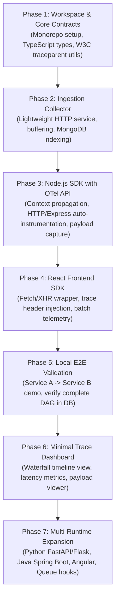

# Doomwatch: Step-by-Step Implementation Plan

This document outlines the phased roadmap and technical steps to build **Doomwatch** using the OpenTelemetry API for context propagation, an Ingestion Collector, and an MVP covering Node.js and React before expanding to Python and Spring Boot.

---

## 1. Architecture & Monorepo Layout

To manage multiple SDKs, the ingestion server, and the dashboard cleanly without multi-repo overhead, we organize Doomwatch as a **monorepo**:

```text
doomwatch/
├── packages/
│   ├── core/                  # Shared data models, types, W3C parser/serializer
│   ├── collector/             # Ingestion API (receives spans, buffers, persists to MongoDB)
│   ├── sdk-node/              # @doomwatch/node (OTel context, Express/Fastify/HTTP interceptors)
│   ├── sdk-react/             # @doomwatch/react (fetch/XHR interceptor & session tracer)
│   └── dashboard/             # Web UI (trace waterfall, latency graph, payload inspector)
├── examples/
│   ├── service-a/             # Sample Node.js Express service (calls Service B)
│   ├── service-b/             # Sample Node.js service (returns processed response)
│   └── sample-react-app/      # Sample React frontend calling Service A
├── docker-compose.yml         # Local MongoDB + Collector + Demo Services
├── package.json               # Root workspace configuration (pnpm or npm workspaces)
├── doomwatch_ideation.txt     # Original concept & requirements
├── doomwatch_architecture.md  # Architectural specification & DAG models
└── doomwatch_plan.md          # This implementation plan
```

---

## 2. Phased Roadmap



---

## 3. Detailed Milestone Breakdown

### Milestone 1: Workspace Setup & Shared Data Contracts (`packages/core`)
* **Goal**: Establish the repository foundation and shared contracts so all SDKs and services speak the exact same language.
* **Deliverables**:
  1. Monorepo configuration (`package.json` with npm/pnpm workspaces, TypeScript, ESLint).
  2. `packages/core/src/types.ts`:
     * `Span`: `trace_id`, `span_id`, `parent_span_id`, `service_name`, `name`, `start_time_unix_ms`, `duration_ms`, `http` (url, method, status_code, headers, request_body, response_body), `error`.
     * `Trace`: Aggregated span collection for visualization.
  3. `packages/core/src/w3c.ts`:
     * Utilities to parse and generate W3C `traceparent` (`00-{trace_id}-{span_id}-{flags}`).
     * Fallback helper to extract legacy `x-tracing-id` or generate a new random 128-bit UUID.

---

### Milestone 2: Doomwatch Ingestion Collector (`packages/collector`)
* **Goal**: High-throughput, non-blocking ingestion service that validates spans and writes them in batches to MongoDB.
* **Key Components**:
  1. **Endpoints**:
     * `POST /v1/traces`: Accepts array of spans from SDKs (`application/json`).
     * `GET /v1/traces`: Query traces with filters (`service`, `statusCode`, `minDuration`, `hasError`, `limit`).
     * `GET /v1/traces/:traceId`: Returns complete DAG (all spans for a given trace).
     * `GET /health`: Health check endpoint.
  2. **Batch Queue & Flusher**:
     * Ingested spans are pushed to an in-memory ring buffer (e.g. 1,000 capacity).
     * Flushed to MongoDB via `insertMany` every 500ms or when batch size hits 50.
  3. **MongoDB Schema & Indexes**:
     * Collection: `spans`
     * Indexes: `{ trace_id: 1 }`, `{ service_name: 1, start_time_unix_ms: -1 }`, `{ "http.status_code": 1 }`.

---

### Milestone 3: Node.js SDK (`packages/sdk-node`)
* **Goal**: 2-line initialization in user services with zero modification to business logic.
* **Key Components**:
  1. **OpenTelemetry API Integration**:
     * Dependency: `@opentelemetry/api` (pure context API, <15kb).
     * Uses OpenTelemetry's standard `context.with()` and `trace.setSpanContext()`, which wraps Node's native `AsyncLocalStorage`.
  2. **Incoming Request Interceptor (Express / Node HTTP)**:
     * Middleware that extracts `traceparent` (or `x-tracing-id`). If none exists, creates a fresh `trace_id`.
     * Starts a new server span and binds it to the current async context.
     * Hooks `res.end()` to calculate latency, record status code, and capture response body.
  3. **Outgoing Request Interceptor (`http.request` / `fetch` / `axios`)**:
     * Automatically wraps Node's native `http.request` and global `fetch`.
     * Checks if an ambient span is active in the async context.
     * If active: injects `traceparent` with current `trace_id` and new child `span_id`.
     * If inactive: generates a new root trace ID.
  4. **Payload Capture & Redaction**:
     * Body truncation (default limit: 4KB).
     * Redaction of sensitive fields (`password`, `authorization`, `token`, `secret`).
  5. **Background Batch Exporter**:
     * Queues spans in memory and flushes to the Collector asynchronously every 1 second (fail-open: never slows down or crashes the host service).

---

### Milestone 4: React Frontend SDK (`packages/sdk-react`)
* **Goal**: Track user API requests from the browser and attach initial `traceparent` headers to backend calls.
* **Key Components**:
  1. **Window `fetch` & `XMLHttpRequest` Patch**:
     * Automatically injects `traceparent` header into all outgoing requests.
     * Records client-side latency and HTTP status code.
  2. **Security Safeguard**:
     * Frontend SDK points **only** to the Doomwatch Collector endpoint (or backend proxy) with no database credentials.
  3. **React Provider / Hook**:
     * `<DoomwatchProvider collectorUrl="..." appName="web-store">` wrapper for painless React integration.

---

### Milestone 5: Local E2E Verification & Testing (`examples/`)
* **Goal**: Prove end-to-end trace correlation across multiple services without manual parameter passing.
* **Setup**:
  * Run local MongoDB via `docker-compose.yml`.
  * Start `packages/collector` on port 4000.
  * Start `examples/service-a` (Order Service) on port 3001 with `@doomwatch/node`.
  * Start `examples/service-b` (Payment Service) on port 3002 with `@doomwatch/node`.
  * Start `examples/sample-react-app` on port 5173 with `@doomwatch/react`.
* **Verification Scenario**:
  1. Click "Purchase" in the React app.
  2. React calls Service A (`/order`).
  3. Service A internally calls Service B (`/payment`).
  4. Inspect MongoDB to verify:
     * Exactly 1 `trace_id` links all 3 steps.
     * `Service A` span points to `Frontend` span as parent.
     * `Service B` span points to `Service A` span as parent.
     * Status codes, latencies, and sanitized payloads are captured accurately.

---

### Milestone 6: Web Dashboard (`packages/dashboard`)
* **Goal**: Visual interface to explore traces, inspect errors, and analyze performance.
* **Key Features**:
  1. **Trace Explorer**: Filterable list (Search by Trace ID, Service, Status Code $4xx/5xx$, Latency range).
  2. **Waterfall Flame Chart**: Shows the DAG hierarchy, start offset, and duration of every span.
  3. **Span Detail Modal**: Displays request URL, headers, request body, response body, and error stack traces.

---

### Milestone 7: Long-Term Multi-Runtime Expansion
* **Python SDK (`doomwatch-python`)**:
  * FastAPI middleware + Flask extension using `contextvars` and `opentelemetry-api`.
  * Auto-instrumentation for `requests` and `httpx`.
* **Java Spring Boot Starter (`doomwatch-spring-boot-starter`)**:
  * Servlet Filter + `RestTemplate`/`WebClient` interceptor using `ThreadLocal`/Micrometer.
* **Angular SDK (`@doomwatch/angular`)**:
  * Angular `HttpInterceptor` module.
* **Queue Tracing**:
  * Helper wrappers for Kafka (`KafkaJS`, `confluent-kafka`), RabbitMQ (`amqplib`), and BullMQ to inject/extract trace context across async boundaries.

---

## 4. Immediate Next Step

To begin implementation cleanly, our immediate first step will be:
1. **Initialize the Monorepo Structure & Configs** (create `package.json`, TypeScript configs, and workspace directories).
2. **Implement `packages/core`** (define the data schema and W3C traceparent utilities).
3. **Implement `packages/collector`** (the ingestion server with MongoDB connection and batch storage).
